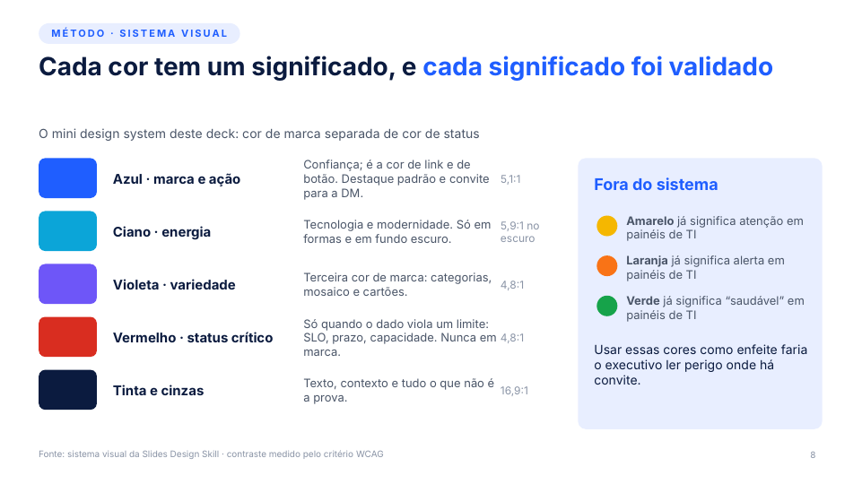
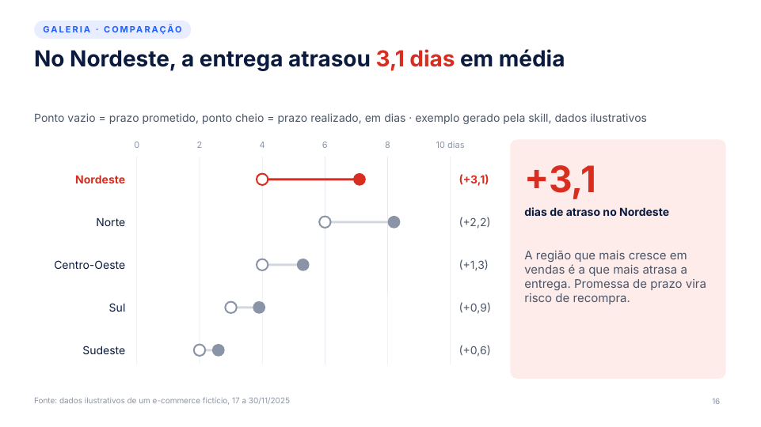
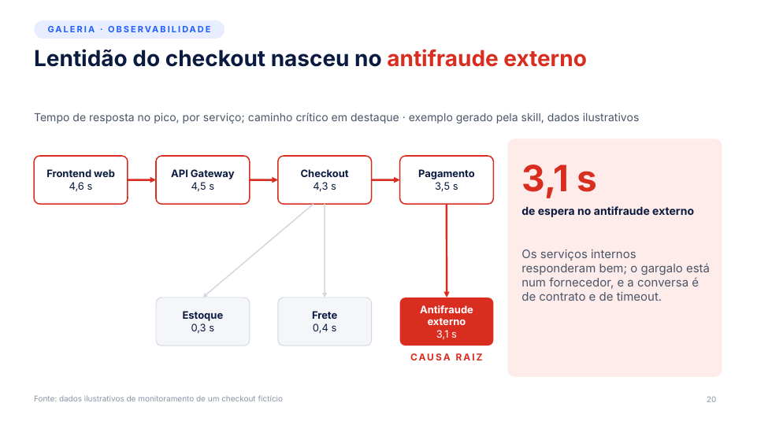
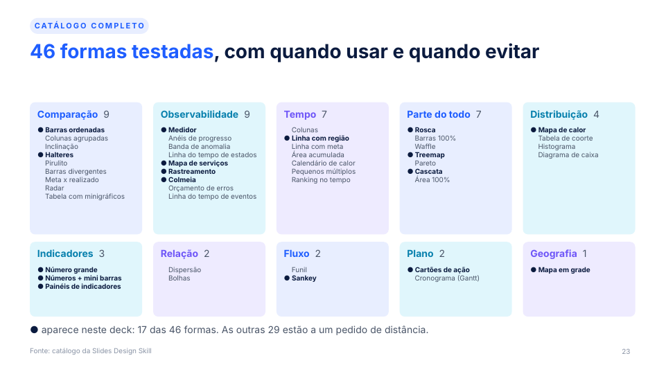

# Slides Design Skill

**Uma skill para o Claude que transforma dados em slides executivos prontos para decidir.**

A Slides Design Skill atua como diretor de arte de apresentações executivas e de vendas. Ela escreve o título de ação, escolhe o gráfico certo entre 46 formas testadas, aplica um design system com cores de significado validado e critica o próprio slide antes de entregar o PowerPoint.


## O que ela faz

- **Títulos de ação.** Troca rótulos de tópico ("Resultados da POC") por conclusões com número ("POC encontrou a causa raiz em 4 min, contra 2 h hoje"), com trava de honestidade: encurtar nunca autoriza afirmar mais do que o dado mostra.
- **Escolha do gráfico.** Parte do verbo do título, filtra pelo formato dos dados e pelo contexto da audiência. São 46 formas em 10 famílias, cada uma com quando usar, quando evitar, título-modelo e receita de construção.
- **Gestalt e destaque único.** Cinza para o contexto, uma cor para a prova, rótulos diretos no lugar de legenda.
- **Design system Sinal.** Cor é significado: marca em tons frios (azul, ciano, violeta), vermelho só como status crítico, amarelo, laranja e verde fora como enfeite. Todos os pares de texto passam no contraste WCAG.
- **Roteiros de vendas e pré-vendas.** Resultado de POC, business case e ROI, discovery, QBR, comparativo com concorrente e RFP, pós-incidente e resultado comercial.
- **Crítica de designer obrigatória.** Renderiza, responde 13 checagens (da mensagem em 3 segundos à semântica de cor) e corrige antes de entregar.

| Chamada para ação em azul de link | Design system com significado | Status crítico só em problema |
|---|---|---|
|  |  |  |

| Observabilidade como língua nativa | Catálogo das 46 formas |
|---|---|
|  |  |

## Como instalar

A skill é a pasta `skill/slides-design-skill/`, com o `SKILL.md` dentro.

**Claude (app e web).** Gere o pacote e envie o `.zip` na área de Skills das configurações:

```bash
./scripts/package.sh        # cria dist/slides-design-skill.zip
```

**Claude Code.** Copie a pasta para o diretório de skills pessoal ou do projeto:

```bash
cp -r skill/slides-design-skill ~/.claude/skills/          # pessoal
cp -r skill/slides-design-skill .claude/skills/            # só neste projeto
```

**Dependência.** A Slides Design Skill é a camada de narrativa, gráfico e design. A mecânica do arquivo `.pptx` (pptxgenjs, edição de template, validação e renderização) vem da skill `pptx`, que precisa estar disponível no mesmo ambiente.

## Como usar

Peça o deck dizendo a decisão que você quer e mande os dados:

> Monte o deck de resultado da POC para o comitê de compras. Decisão esperada: aprovar a implantação. Dados em anexo.

> Revise este deck: reescreva os títulos como títulos de ação e troque os gráficos que não provam o título.

A skill devolve o `.pptx`, o roteiro de títulos, o que ela assumiu, quais gráficos são nativos (editáveis) e quais foram desenhados com formas.

## Exemplo de referência

[`examples/pitch-deck/`](examples/pitch-deck/) traz o pitch da própria skill (25 slides) gerado com ela, no design system Sinal: o `.pptx`, o `.pdf` e o gerador em pptxgenjs.

```bash
cd examples/pitch-deck
PPTX_SKILL_DIR=/caminho/da/skill/pptx node deck.js   # o caminho aplica as cores ao tema do PowerPoint
python3 post.py Slides_Design_Skill_pitch.pptx       # lacunas de séries e número junto da unidade
```

Os dados da galeria são ilustrativos, de um e-commerce e de um checkout fictícios.

## Estrutura do repositório

```
skill/slides-design-skill/SKILL.md   a skill (o que o Claude lê)
design-system/sinal.tokens.json      tokens do design system Sinal
design-system/README.md              regras de uso das cores, com contraste
examples/pitch-deck/                 deck de referência e gerador
scripts/contrast.py                  confere o contraste WCAG dos tokens
scripts/package.sh                   gera o .zip para upload
docs/images/                         prévias usadas neste README
SPEC.md                              especificação do projeto, decisões e roadmap
CHANGELOG.md                         histórico de versões
CONTRIBUTING.md                      como evoluir a skill
```

## Fonte

Aptos é a fonte padrão. Se ela não estiver instalada no ambiente que renderiza a conferência, o LibreOffice usa uma fonte mais larga no lugar, então a conferência fica conservadora. Para um PDF fiel, exporte pelo PowerPoint (Arquivo > Exportar > PDF).

## Licença

[MIT](LICENSE).
